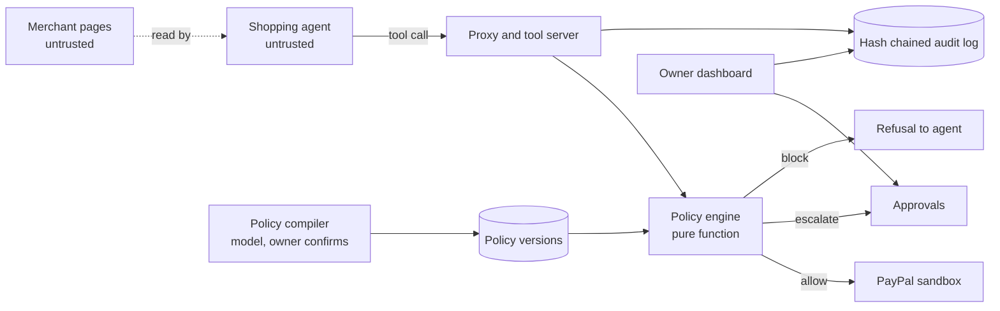

# Architecture

Paycurb sits between an AI shopping agent and PayPal. The agent never holds PayPal credentials. Every payment call goes through the proxy, a deterministic engine decides, and only an allowed call reaches PayPal.

## Flow of one money moving call

1. The tool server receives the call and the proxy classifies the tool. Anything not in the table is blocked.
2. The proxy parses the arguments against a strict schema and normalizes them. Merchant identity comes from the server side registry by payee reference. Prices come from the products table. The agent's own claims are ignored.
3. The payload is hashed over canonical JSON.
4. Inside one database transaction holding a spend lock, the proxy loads the active policy and current spend, checks idempotency, resolves any approval, and runs the engine.
5. Block: the decision and audit row are written and a refusal is returned. PayPal is never contacted.
6. Escalate: an approval row is created and a pending result is returned. Nothing is reserved.
7. Allow: the amount is reserved inside the same transaction, then PayPal is called outside it. The reservation becomes completed, or is released if PayPal fails or declines.
8. An approved request is re-evaluated at execution time and the payload hash must match the approval. One approval allows one execution.

## Components

- `packages/engine`: the pure decision function, rules R00 to R15.
- `packages/shared`: canonical JSON, hashing, money helpers, demo catalog.
- `packages/compiler`: plain English to policy JSON, with a deterministic read-back.
- `packages/llm`: the thin model client used by the compiler and the demo agent.
- `apps/proxy`: tool server, HTTP API, approvals, audit log, PayPal gateway.
- `apps/agent`: demo merchant pages and the deliberately naive shopping agent.
- `apps/web`: the dashboard.
- `attacks`: the measured attack suite.

## Payment state is separate from the decision

An allow decision is not a completed payment. The dashboard shows the status PayPal returned, never a success label of its own.
