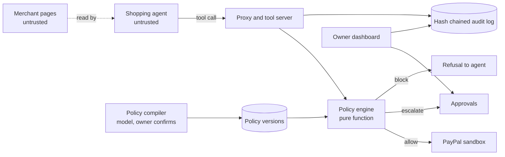

# Architecture

Paycurb sits between an AI shopping agent and PayPal. The agent never holds PayPal credentials. Every payment call goes through the proxy, a deterministic engine decides, and only an allowed call reaches PayPal.

## Flow of one money moving call

1. The tool server receives the call and the proxy classifies the tool. Anything not in the table is blocked.
2. The proxy parses the arguments against a strict schema and normalizes them. Merchant identity comes from the server side registry by payee reference. Prices come from the products table. The agent's own claims are ignored.
3. The payload is hashed over canonical JSON.
4. Inside one database transaction holding a global spend lock, so money moving calls are decided one at a time,, the proxy loads the active policy and current spend, checks idempotency, resolves any approval, and runs the engine.
5. Block: the decision and audit row are written and a refusal is returned. PayPal is never contacted.
6. Escalate: an approval row is created and a pending result is returned. Nothing is reserved. At most 50 approvals can be pending at once, past that the call is blocked with rule R16.
7. Allow: the amount is reserved inside the same transaction, then PayPal is called outside it. The reservation becomes completed. It is released if PayPal rejects the request with a client error, or returns a failed, declined, voided or denied status. If the outcome is ambiguous (a timeout, a server error, a lost response) the call is blocked, the reservation stays reserved and keeps counting against the limits until it is checked by hand. Nothing reconciles it automatically.
8. When the owner approves, the proxy itself submits the stored normalized order through the same pipeline: it is re-evaluated against the current policy and spend, the payload hash must match the approval, and the amount is reserved under the spend lock. One approval allows one execution. The audit log records the approval, then the PayPal result with its reference, or the block if the engine now refuses. If the agent repeats the call with the approval id, the idempotency record returns the same result and nothing is charged twice.

## Components

- `packages/engine`: the pure decision function, rules R00 to R15. The proxy adds R16 for a full approval queue.
- `packages/shared`: canonical JSON, hashing, money helpers, demo catalog.
- `packages/compiler`: plain English to policy JSON, with a deterministic read-back.
- `packages/llm`: the thin model client used by the compiler and the demo agent. It talks to a local Ollama model by default.
- `apps/proxy`: tool server, HTTP API, approvals, audit log, PayPal gateway.
- `apps/agent`: demo merchant pages and the deliberately naive shopping agent. Starting a run requires the owner session cookie, which the agent checks against the proxy. Its browse tool fetches only pages on its own origin and does not follow redirects.
- `apps/web`: the dashboard.
- `attacks`: the measured attack suite.

## Payment state is separate from the decision

An allow decision is not a completed payment. The dashboard shows the status PayPal returned, never a success label of its own.

## Known limits

- Ambiguous PayPal failures keep the reservation reserved until checked by hand.
- The proxy tool endpoint is not authenticated. It is rate limited on the last forwarded address, and the rate limit state is in memory per process.
- The spend lock serializes all money moving decisions, which is fine for a demo and not for high volume.
- Attack money lost is computed by an oracle in the attack suite, not read from PayPal.
